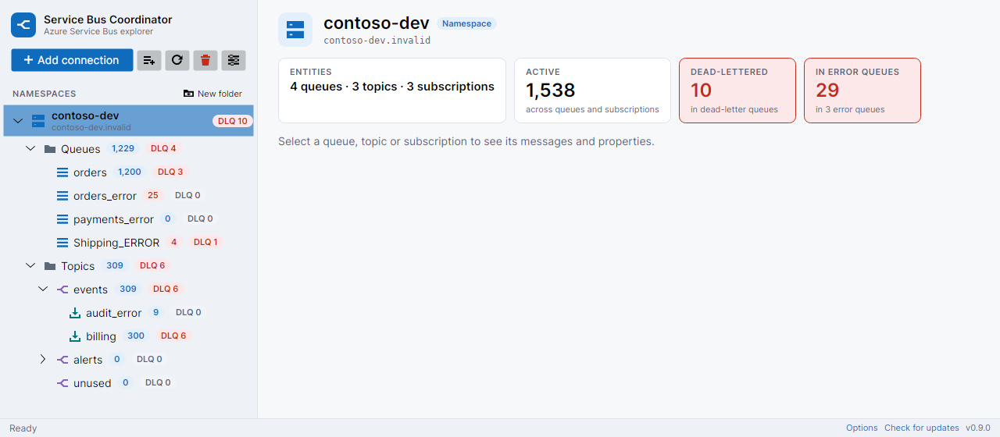
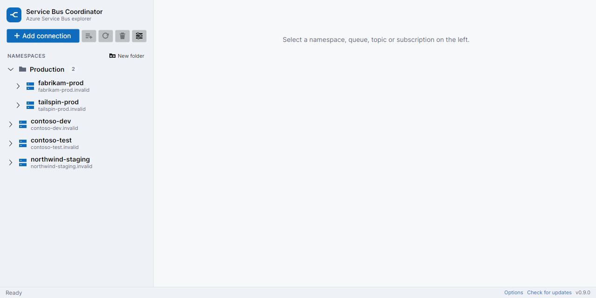
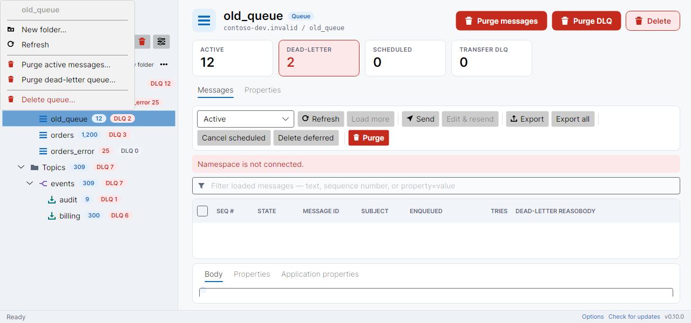
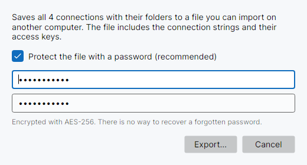
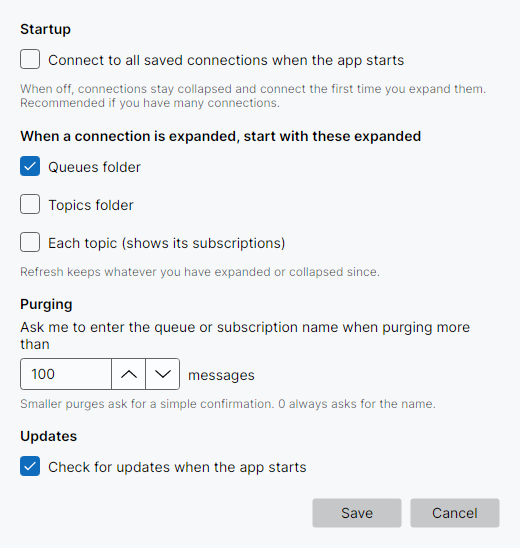

# Service Bus Coordinator

**A fast, free desktop explorer for Azure Service Bus on Windows, macOS and Linux.**
See what is in every queue and subscription at a glance, find out why messages failed, put them back where they
belong, and clean up, without opening the Azure portal or writing a script.



## Why Service Bus Coordinator

- **See problems at a glance.** Every queue, topic and subscription shows its active and dead-letter counts, and the
  totals add up on each folder, topic and connection. Dead-letters show in red, and so do error queues (`orders_error`)
  that hold messages. The namespace overview sums up active, dead-lettered and error-queue messages.
- **Fix failed messages in a few clicks.** Read dead-lettered messages with the reason and description, then
  **resubmit** some or all of them to the original queue or topic, or to any other.
- **Clean up safely.** Big **Purge messages** and **Purge DLQ** buttons, progress you can cancel, and a confirmation
  that asks for the name (with a Copy button) before anything large is deleted.
- **Your keys stay safe.** Connection strings live in your operating system's secure storage (Windows DPAPI, macOS
  Keychain, libsecret on Linux), and exports are password-encrypted by default.
- **Opens instantly, however many connections you have.** A connection only connects when you expand it.
- **One download, nothing to install.** A single self-contained app for Windows, macOS (Apple silicon and Intel) and
  Linux, and it **updates itself** in place.

## Features

### Connections
- **Many namespaces side by side.** Paste a connection string; the name fills in automatically.
- **Folders, drag and drop.** Group connections in folders (Production, Test…) and drag connections and folders to
  file them or change their order.
- **Export and import all connections**, with their folders and order, to move to a new computer or share a set-up
  with your team. The file is AES-256 encrypted with a password you choose; importing skips connections you already have.
- **Works with limited rights.** With a Listen or Send connection string you can still add queues and subscriptions
  by name and work with their messages.
- **Local Service Bus emulator** supported.

### Browsing and monitoring
- Queues, topics and subscriptions in one tree, with **active and dead-letter counts on every row** and totals on
  each folder, topic and connection.
- **Error queues stand out:** queues ending in `_error` show their count in red, and the Queues folder shows the total
  waiting in them. The endings are configurable.
- A **namespace overview** with total active, dead-lettered and error-queue messages.
- **Entity properties:** lock duration, time-to-live, max delivery count, sessions, duplicate detection, forwarding,
  auto-delete, sizes, shared access policy names, and **subscription rules** (SQL and correlation filters).
- **Collapse all** with one click to tidy a long tree back to just your connections and folders. Connections stay
  connected.
- **Right-click** any queue or subscription to refresh, purge or delete it.

### Messages
- **Read messages without removing them**, page by page, from the active queue, the dead-letter queue or the
  transfer dead-letter queue.
- **Formatted bodies** (JSON, XML, text, or hex for binary), all system properties and application properties.
- **Filter** loaded messages by text, sequence number or `property=value`.
- **Send** new messages, or **edit and resend** an existing one, with properties and application properties.
- **Resubmit dead-lettered messages** to their source or another entity, optionally removing the dead-letter details
  and stamping where they came from.
- **Export** selected or all messages to JSON.
- **Sessions, scheduled and deferred messages:** browse session-enabled entities, cancel scheduled messages and
  delete deferred ones.

### Cleaning up
- **Purge** active messages or the dead-letter queue from the large header buttons, the toolbar or the context menu,
  with progress and cancel. Purge also clears deferred and scheduled messages.
- **Delete queues and subscriptions** you no longer need. You type the name to confirm, and the counts and tree
  update straight away.

### Comfort
- **Zoom** the whole window with **Ctrl +** / **Ctrl −** or **Ctrl + mouse wheel** (Cmd on macOS), and **Ctrl+0**
  to reset. The level is remembered.
- **Options** for the defaults: connect everything at startup, which folders start expanded, which queue names count
  as error queues, when a purge asks for the name, and whether to check for updates.
- **Light and dark themes** that follow your OS.
- **Updates itself:** when a new version is out, click **Update and restart**. Set the environment variable
  `SBC_DISABLE_UPDATE_CHECK=1` to stop the check on startup.

### Screenshots

| | |
|---|---|
|  |  |
| Folders, counts and error queues | Purge and delete from the queue header |
|  |  |
| Password-protected connection export | Options |

## Install

1. Open the [latest release](https://github.com/jeangilbertlouis/service-bus-coordinator/releases/latest).
2. Download the file for your system:

   | System | File |
   |---|---|
   | Windows | `…-win-x64.zip` |
   | macOS (Apple silicon) | `…-osx-arm64.zip` |
   | macOS (Intel) | `…-osx-x64.zip` |
   | Linux | `…-linux-x64.tar.gz` |

3. Unpack it and start **ServiceBusCoordinator** (on macOS, **Service Bus Coordinator.app**). No .NET install is needed.

The app is not code-signed yet, so the first launch shows a warning:

- **Windows:** on the SmartScreen prompt, choose **More info → Run anyway**.
- **macOS:** right-click the app, choose **Open**, then confirm.
- **Linux:** you may need to make the file executable (`chmod +x ServiceBusCoordinator`). Secure storage needs
  `libsecret`, which most desktop distributions already include.

## Get started

1. Click **Add connection** and paste a Service Bus connection string. You can find it in the Azure portal under your
   namespace → **Shared access policies**. The name fills in automatically.
2. Pick a queue or subscription in the tree to see its messages. Switch to **Dead-letter** to see failed messages.
3. Tick messages and choose **Resubmit**, or use **Purge** to clear the list. Both ask before changing anything.

### Which connection string should I use?

| Rights | What works |
|---|---|
| **Manage** | Everything: the full tree, counts, entity settings |
| **Listen** / **Send** only | Messages and operations, but you add queues or subscriptions by name with the **add entity** button next to **Add connection** |

Resubmit and purge change real data. Try them on a test namespace or the
[local emulator](docs/DEVELOPMENT.md#local-emulator-optional) first.

## For developers

Service Bus Coordinator is built with .NET 10 and [Avalonia UI](https://avaloniaui.net/). To run it from source:

```bash
dotnet run --project src/ServiceBusCoordinator.App
```

- [Developer guide](docs/DEVELOPMENT.md): building, testing, packaging, the emulator, the code layout, and how to add
  features.
- [Design document](docs/DESIGN.md): architecture, decisions, and the roadmap of future improvements.

Contributions are welcome. See [Contributing](docs/DEVELOPMENT.md#contributing).

## License

[MIT](LICENSE). Not affiliated with or endorsed by Microsoft.
